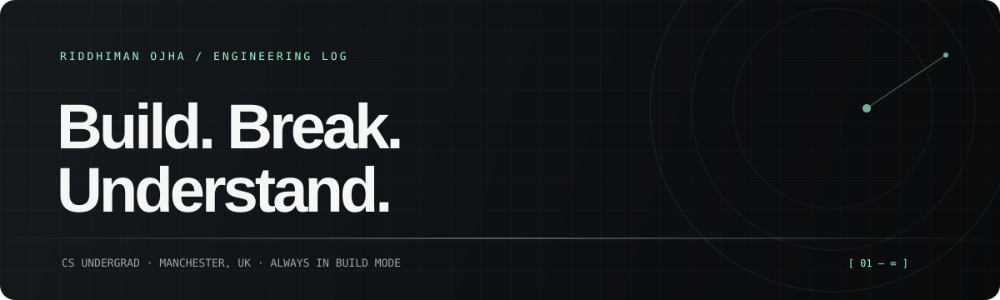

<!--
  Riddhiman Ojha · GitHub profile
  A little less noise. A little more signal.
-->

  

 

  <code>COMPUTER SCIENCE · UNIVERSITY OF MANCHESTER · UNITED KINGDOM</code>
    
  <h2>Curious by default. Building to find out.</h2>
  

    I’m a computer science student interested in the space between software engineering,
    product thinking and the things people actually use.
    I like taking an idea from a rough sketch to something working, then pulling it apart
    to understand how it could be better.
  

  

    <a href="https://github.com/riddhimanojha?tab=repositories">PROJECTS</a>
    &nbsp; / &nbsp;
    <a href="https://github.com/riddhimanojha">GITHUB</a>
  

 

## 01 / CURRENTLY

- Building **Yukti**, a practice platform for technical recruitment assessments, with AI-assisted code review and debugging at its core.
- Exploring how thoughtful interfaces can make complex tools feel simple.
- Studying Computer Science at the University of Manchester.

## 02 / SELECTED WORK

| Project | What it is |
|:--|:--|
| [Yukti](https://github.com/riddhimanojha/yukti) | A candidate-focused platform for practising technical recruitment assessments. |
| [SkillVerse](https://github.com/riddhimanojha/SkillVerse) | A web-based learning platform. **2nd place, GreatUniHack 2025.** |
| [Orion](https://github.com/riddhimanojha/Orion) | A project built during a hackathon at Imperial College London. |
| [SIMDU](https://github.com/riddhimanojha/SIMDU) | A software project exploring simulation and system design. |
| [Delhi Metro](https://github.com/riddhimanojha/Delhi-Metro) | A project inspired by the Delhi Metro network. |

Some projects are experiments; others are works in progress. The code tells the fuller story.

## 03 / TOOLKIT

<TypeScript> · JavaScript · Python · Java  
React · Next.js · Tailwind CSS · SQL  
Git · Linux · Prisma · PostgreSQL

## 04 / PRINCIPLE

> Make it work. Make it clear. Then make it worth keeping.

 

  <code>NO BADGE COLLECTION. NO FAKE GRINDSET. JUST THE WORK.</code>
    
  <a href="https://github.com/riddhimanojha">riddhimanojha</a>

