<!--
  R/O · the personal operating system of Riddhiman Ojha.
  Every image here is generated by code in scripts/. See scripts/README.md.
-->

<a id="init"></a>

<picture>
  <source media="(prefers-reduced-motion: reduce)" srcset="assets/header-static.png">
  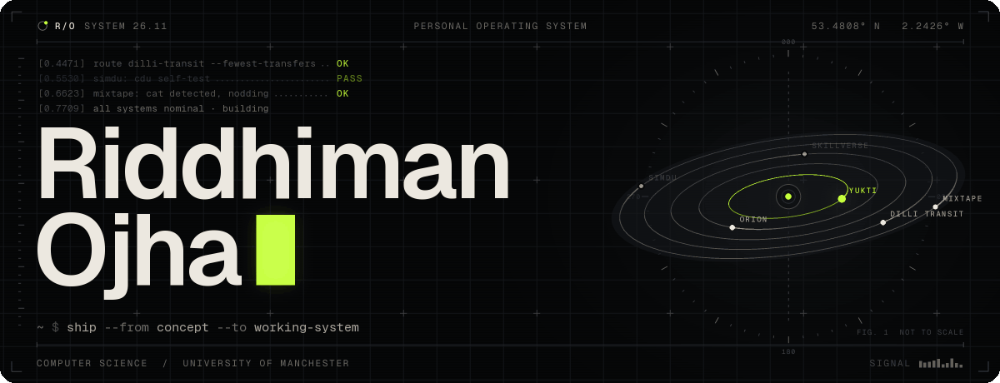
</picture>

<p align="center">
  <a href="#status"><code>01&nbsp;STATUS</code></a>&nbsp;&nbsp;
  <a href="#building"><code>02&nbsp;BUILDING</code></a>&nbsp;&nbsp;
  <a href="#experiments"><code>03&nbsp;EXPERIMENTS</code></a>&nbsp;&nbsp;
  <a href="#stack"><code>04&nbsp;STACK</code></a>&nbsp;&nbsp;
  <a href="#log"><code>05&nbsp;NOTES</code></a>&nbsp;&nbsp;
  <a href="#eof"><code>06&nbsp;EOF</code></a>
</p>

<br>

<picture>
  <source media="(prefers-color-scheme: light)" srcset="assets/strip-init-light.svg">
  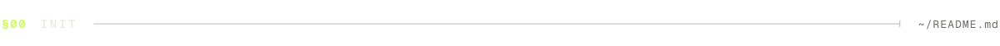
</picture>

<picture>
  <source media="(prefers-color-scheme: light)" srcset="assets/intro-light.svg">
  
</picture>

I study Computer Science at the University of Manchester. I build software, test ideas against reality, and like taking a product from a sentence in a notebook to something you can open in a browser. Some of it is serious. Some of it has a cat on it.

<br>

<a id="status"></a>

<picture>
  <source media="(prefers-color-scheme: light)" srcset="assets/strip-status-light.svg">
  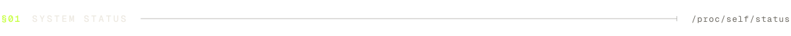
</picture>

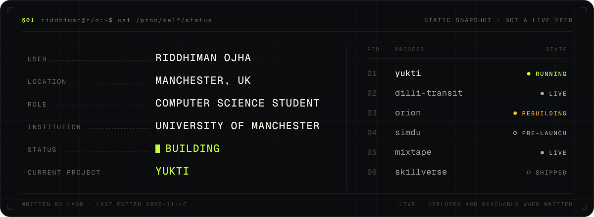

<br>

<a id="building"></a>

<picture>
  <source media="(prefers-color-scheme: light)" srcset="assets/strip-building-light.svg">
  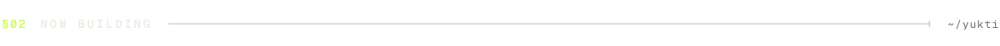
</picture>

<a href="https://yukti-green.vercel.app">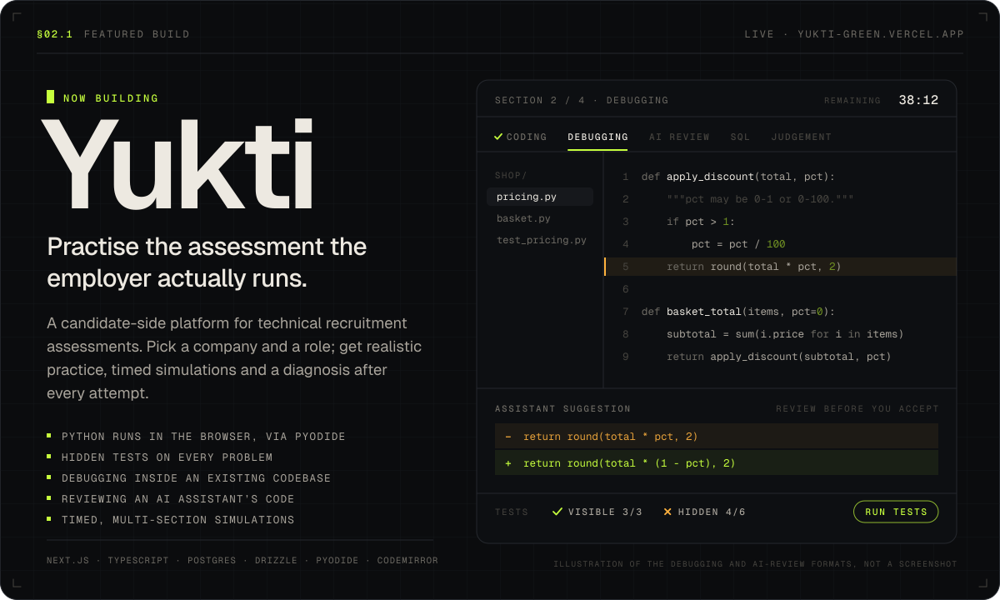</a>

**Yukti** is a practice platform for the online assessments that filter most applicants to software internships and graduate schemes. Tell it the company and role you are preparing for and it gives you realistic practice, timed multi-section simulations and a specific diagnosis after every attempt. The formats I care most about are the new ones: fixing bugs inside an existing codebase, and reviewing code an AI assistant wrote before you accept it. All of it runs as real Python in the browser.

<sub><a href="https://yukti-green.vercel.app"><b>OPEN YUKTI&nbsp;↗</b></a>&nbsp;&nbsp;·&nbsp;&nbsp;yukti-green.vercel.app&nbsp;&nbsp;·&nbsp;&nbsp;source private</sub>

<br>

<a id="experiments"></a>

<picture>
  <source media="(prefers-color-scheme: light)" srcset="assets/strip-experiments-light.svg">
  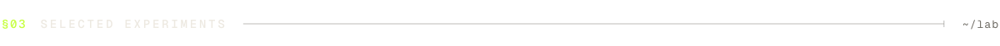
</picture>

<a href="https://github.com/riddhimanojha/SkillVerse">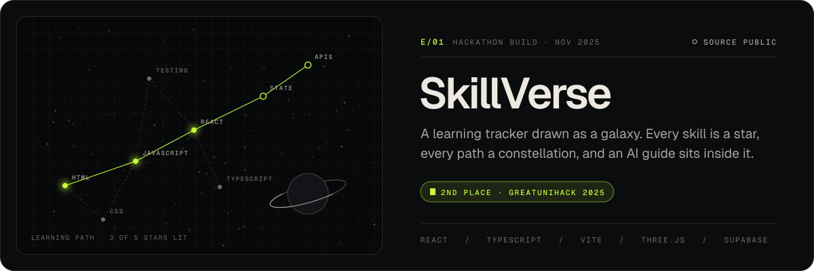</a>
<sub><b>2nd place at GreatUniHack 2025.</b>&nbsp;&nbsp;·&nbsp;&nbsp;<a href="https://github.com/riddhimanojha/SkillVerse"><b>SOURCE&nbsp;↗</b></a></sub>

<br>

<a href="https://orion-lake-tau.vercel.app">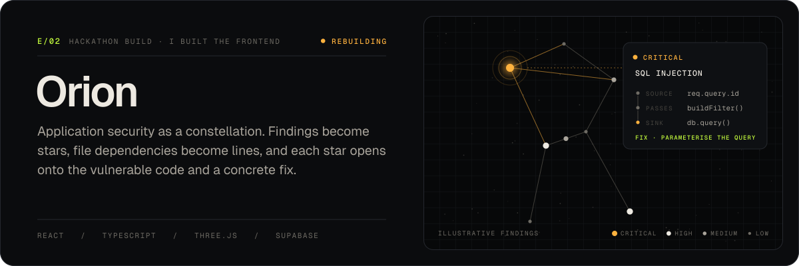</a>
<sub>Started at a hackathon, where I built the frontend. Now being rebuilt properly.&nbsp;&nbsp;·&nbsp;&nbsp;<a href="https://orion-lake-tau.vercel.app"><b>LIVE&nbsp;↗</b></a>&nbsp;&nbsp;·&nbsp;&nbsp;source private</sub>

<br>

<a href="https://delhimetro-ten.vercel.app">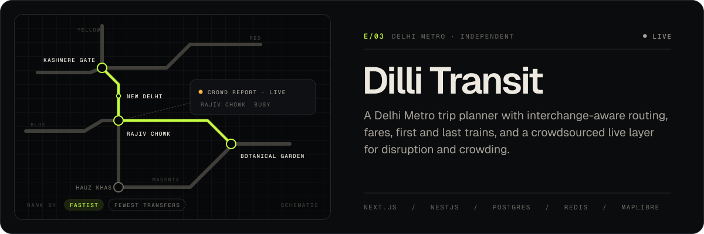</a>
<sub>Routing is a graph search ranked by fastest or fewest transfers; crowd reports stream in live.&nbsp;&nbsp;·&nbsp;&nbsp;<a href="https://delhimetro-ten.vercel.app"><b>LIVE&nbsp;↗</b></a>&nbsp;&nbsp;·&nbsp;&nbsp;source private</sub>

<br>

<a href="https://simdu.vercel.app">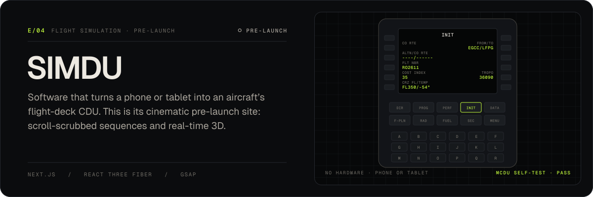</a>
<sub>The site makes you wait for the MCDU self-test before it lets you in.&nbsp;&nbsp;·&nbsp;&nbsp;<a href="https://simdu.vercel.app"><b>LIVE&nbsp;↗</b></a>&nbsp;&nbsp;·&nbsp;&nbsp;source private</sub>

<br>

<a href="https://ipod-rho.vercel.app">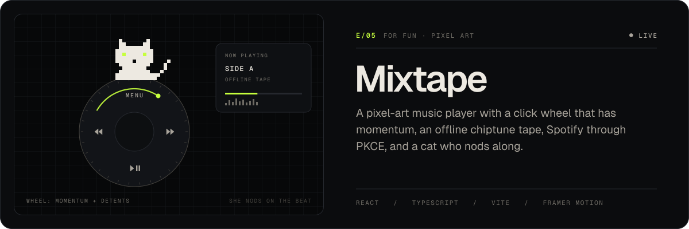</a>
<sub>Tap the cat five times.&nbsp;&nbsp;·&nbsp;&nbsp;<a href="https://ipod-rho.vercel.app"><b>LIVE&nbsp;↗</b></a>&nbsp;&nbsp;·&nbsp;&nbsp;source private</sub>

<br>

<details>
<summary><code>$ ls ~/lab --no-public-link</code>&nbsp;&nbsp;two more builds</summary>

<br>

```text
jarvis/       A local, voice-first desktop assistant.
              Whisper for speech, Piper for its voice, Ollama or Claude
              for thinking. PySide6 + QML HUD, SQLite memory,
              and a background mode you start with a clap.

simdu-app/    The SIMDU companion itself: an Expo / React Native MCDU
              that flies a simulated A320neo demo flight, so it can be
              shown without a simulator or a network.
```

</details>

<br>

<a id="stack"></a>

<picture>
  <source media="(prefers-color-scheme: light)" srcset="assets/strip-stack-light.svg">
  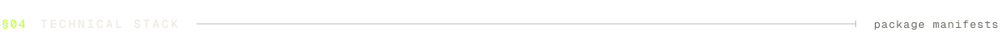
</picture>


<br>

<a id="log"></a>

<picture>
  <source media="(prefers-color-scheme: light)" srcset="assets/strip-log-light.svg">
  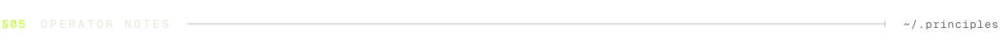
</picture>

```text
riddhiman@r/o:~$ cat ~/.principles

  01  Write down why.           The bigger projects keep a decisions log.
  02  Describe what exists.     A README is not a roadmap.
  03  Say what is broken.       Known issues get their own file.
  04  Fail with directions.     No blank screens. Name the missing variable.
  05  Choose tools on purpose.  Nothing here was picked by default.
  06  Leave room for a cat.     See: Mixtape.
```

<details>
<summary><code>$ dmesg --since 2025</code>&nbsp;&nbsp;the build history, by repository creation date</summary>

<br>

```text
[2025-11-08]  orion        hackathon build: security findings as a constellation
[2025-11-24]  skillverse   GreatUniHack 2025, placed 2nd
[2026-04-10]  jarvis       local voice assistant with a QML HUD
[2026-06-30]  simdu        pre-launch site for a phone-sized CDU
[2026-07-06]  dilli        Delhi Metro planner, milestones 0 to 1c
[2026-07-28]  mixtape      click wheel, chiptune tape, one cat
[2026-10-18]  simdu-app    Expo MCDU flying an A320neo demo flight
[2026-10-28]  yukti        assessment practice  <- you are here
```

</details>

<br>

<a id="eof"></a>

<picture>
  <source media="(prefers-reduced-motion: reduce)" srcset="assets/eof-static.png">
  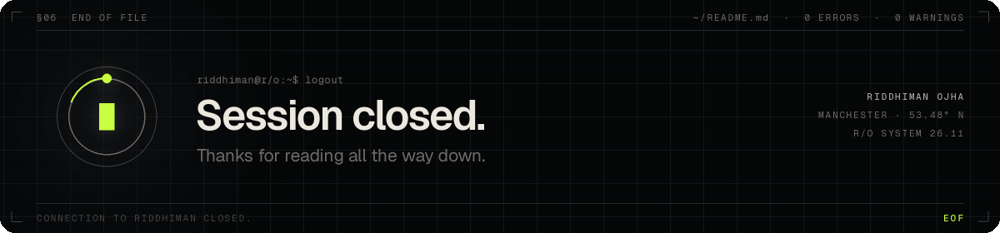
</picture>

<p align="center"><sub>Every image on this page is drawn by code in <a href="scripts"><code>scripts/</code></a>. Set in Geist and Geist Mono.</sub></p>
